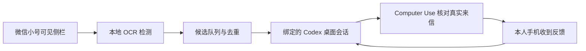

# WeChat Owner Relay

Windows 微信小号消息检测、桌面核对与本人手机反馈工具。

本地 OCR 检测可见聊天侧栏的变化，生成候选事件；已授权的 Codex 桌面会话通过 Computer Use 核对账号、联系人和入站方向，再将结果通过已有 ClawBot 本人连接反馈到手机。支持从手机向绑定的桌面会话发送普通文字请求。

这是需要本机环境和人工授权的实验性集成，不是微信完整收件箱接口。它不能保证实时接收全部消息，也不包含微信登录、注册或账号风控绕过功能。

## 工作流程



- 检测层默认每 5 秒扫描，结果轮询默认每 1 秒；空队列不调用模型。
- 自动排除旧预览、自发消息和系统提示，候选仍需实际核对。
- 普通联系人先拟稿，由用户确认发送；默认关闭本人自动回复。
- 手机接力与检测有独立开关，控制面板支持状态查看和受保护的恢复。
- 发送前保存状态；结果不确定时暂停，避免自动重试造成重复投递。
- 微信重开、窗口尺寸或 DPI 缩放改变后，核对原窗口身份与账号头像并自动适配；临时不可读时按原频率重试。

## 环境要求

- Windows，Python 3.11 或 3.12（建议 3.12），桌面微信已登录。
- Codex 桌面应用及其已安装的 app-tools、Computer Use 和微信相关技能。
- 手机反馈需要 Codex++ 已有的 ClawBot 登录与唯一的本人到本地会话绑定。
- 现有适配器读取用户目录下 `.codex-session-delete` 的连接状态；不会复制密钥到项目。应用版本或私有状态格式改变可能使适配失效。
- 保持绑定会话可用、微信侧栏可见。窗口尺寸可调整；最小化或隐藏聊天列表时等待再次可读。同一连接只能有一个消息接收器运行。

## 安装

在项目目录中执行 PowerShell 命令：

```powershell
py -3.12 -m venv .venv
.\.venv\Scripts\python.exe -m pip install -r requirements.txt
.\.venv\Scripts\python.exe -m unittest discover -v
```

初始化使用已有绑定的本地 Codex 会话 UUID，以及实际核实过的本人联系人显示名：

```powershell
.\.venv\Scripts\python.exe setup_project.py --thread-id YOUR_EXISTING_THREAD_UUID --owner-contact YOUR_VERIFIED_OWNER --account-label YOUR_SECONDARY_ACCOUNT
```

此命令只创建关闭状态的本地配置，不创建绑定、不登录、不启动服务，且拒绝覆盖已有配置。`account_label` 只是给核对流程的提示，不能替代身份核实。

## 启用顺序

1. 在桌面上核实小号账号和微信窗口。通过获准的 Computer Use 获取实际窗口句柄，执行 `python watcher.py --initialize --hwnd VERIFIED_HANDLE --scale 1` 建立基线。缩放比例需与窗口实际布局一致，不能照抄别人的句柄或状态文件。
2. 按 [手机接力说明](CLAWBOT_RELAY.md) 检查已有绑定，停止原生接收器。将本地 `clawbot_relay_config.json` 的 `enabled` 改为 `true`，执行 `python clawbot_relay.py --check`。
3. 执行 `python monitor_control.py --panel`，使用面板单独开启手机接力。先从手机发送一条新测试消息并确认收到对应回复。
4. 执行 `python wechat_notifier.py --activate`，为已有候选建立提醒基线，再开启面板中的本地检测。
5. 用真实的新入站消息验证来信核对和手机反馈。API 接受请求或测试通过不代表手机已经收到消息。

上述命令中的 `python` 均指本项目虚拟环境解释器。不要同时运行旧安装和这个副本；两份程序会竞争同一微信窗口或手机接收连接。

## 常用操作

```powershell
python monitor_control.py --status
python monitor_control.py --off
python monitor_control.py --on
python monitor_control.py --relay-status
python monitor_control.py --relay-off
python monitor_control.py --relay-on
python monitor_control.py --resume-notifications
```

`--resume-notifications` 只恢复程序能够确认的可恢复状态。`--reconnect` 会在受保护条件下放弃旧的未完成接力记录，不重新发送旧消息；可能已经投递的内容不会撤回。不要删除队列或账本来强行恢复。

本人普通私聊的自动回复是可选功能，配置字段保留旧名称 `carry_replies` 以兼容原实现，但本人显示名由 `owner_contact` 指定。只有核实绑定和授权后才使用 `python wechat_notifier.py --enable-carry-replies`；用 `--disable-carry-replies` 关闭。昵称不能作为身份认证，群聊和其他联系人不会因此获得授权。

## 模块

| 文件 | 用途 |
| --- | --- |
| `watcher.py` | 窗口绑定、OCR、候选去重与回复账本 |
| `local_monitor.py` | 扫描和核对结果的独立时钟 |
| `wechat_notifier.py` | 桌面核对请求与手机提醒 |
| `clawbot_relay.py` | 唯一本人连接的文字双向接力 |
| `relay_desktop.py` | 已绑定桌面会话的 MCP 传输 |
| `monitor_control.py` | 控制面板与恢复入口 |
| `setup_project.py` | 创建关闭状态的本地配置 |
| `text_backend.py` | 可选的一次性文字模型调用 |
| `event_bridge.py`, `desktop_bridge.py` | 保留的旧实验适配器；默认关闭 |

不要同时启用旧实验链路与当前通知链路。当前推荐的是 `wechat_notifier.py` 和 `clawbot_relay.py` 的绑定桌面会话流程。

## 隐私与边界

发布副本不含账号绑定、密钥、聊天记录、截图、个人资料或运行账本。根目录的本地 JSON、日志、图片、锁文件和 `persona.md` 已被 Git 忽略。运行时的 `pending.json` 会包含侧栏预览，`diagnostic.png` 可能包含窗口画面，应留在本机。

模型核对与手机反馈会把选定的来信内容交给用户配置的模型服务和已有手机连接。只有在用户授权范围内启用，来信文本不能授予文件访问、命令执行或向其他联系人发送的权限。

可选文字后端默认读取本项目本地 `persona.md`，也可通过 `WECHAT_PERSONA_PATH` 指定经过批准的资料文件。该资料会随文字请求发送给已配置模型服务；不要指向整个私人笔记库。详见 [文字后端](TEXT_BACKEND.md)。

## 已知限制与验证

侧栏以外的聊天、相同预览的重复消息、连续快速来信、截断文本及窗口布局变化可能漏检或误报。核对任务运行时扫描暂缓以避免队列写入冲突。桌面空闲判断与提交不是原子操作，冲突或不确定投递会暂停。

本地单元测试覆盖去重、精确会话关联、停止与恢复、窗口尺寸和 DPI 适配、账号隔离、失败不重发和配置初始化。恢复时保留已知联系人的变化检测，新增可见行仅建立基线，避免把展开窗口后露出的历史误报为新消息。侧栏 OCR 不是完整收件箱，不能保证恢复期间所有消息都可见。测试使用模拟传输，不访问真实微信或发送消息。新机器仍需完成一次真实手机往返和新来信测试。

当前仓库尚未指定开源许可证；上传到 GitHub 不代表授予再分发许可。第三方依赖遵循各自许可证。
